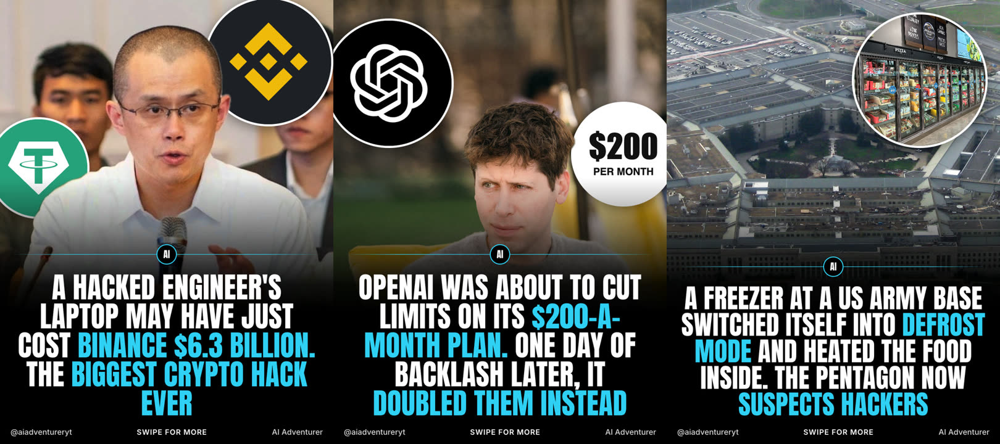
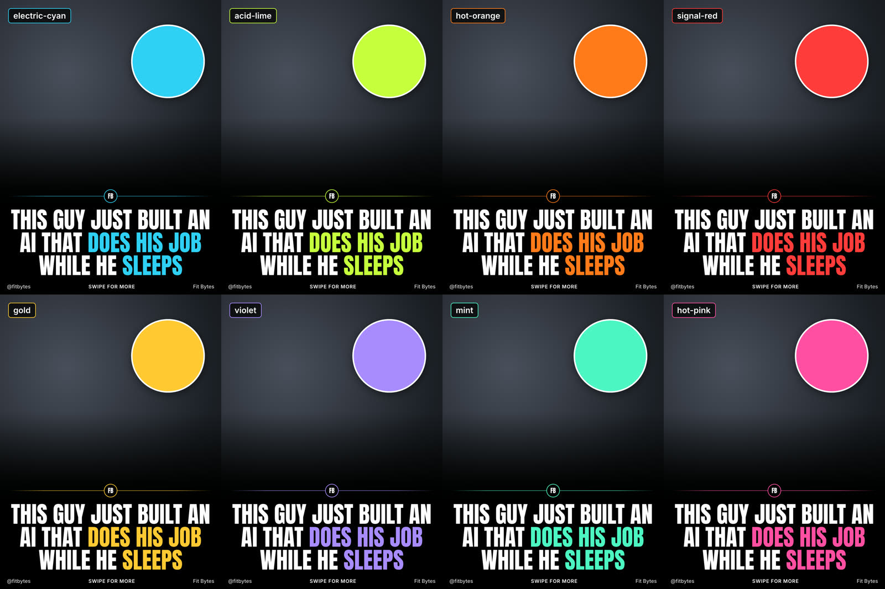

# theme-page

A Claude Code skill for running a news theme page on Instagram or TikTok.

Tell it your niche, your accounts and your logo once, and pick a color. After that, each run:

1. Researches the latest viral news in your niche and shows you a ranked list with real view and like counts.
2. Waits for you to pick the stories.
3. Builds each one into a branded carousel: big caps headline, logo circles, the subject cut out in front, X posts recreated with real stats, and video slides. Every fact gets a source.

It also turns any crazy video (a file, or an X/YouTube/TikTok link) into a 9:16 clip post with your logo, page name and a headline.



Nothing is ever posted for you. You get JPG and MP4 files plus a caption with a sources table.

## Install

**As a plugin** (recommended, easy to update). In Claude Code:

```
/plugin marketplace add sanskarprajapati/theme-page
/plugin install theme-page@theme-page
```

**Or as a plain skill:**

```bash
git clone https://github.com/sanskarprajapati/theme-page.git
mkdir -p ~/.claude/skills
cp -R theme-page/skills/theme-page ~/.claude/skills/
```

Then open Claude Code in the folder where you want your posts saved and type `/theme-page`.

### What your computer needs

| Tool | Needed for | Install |
|---|---|---|
| Python 3.9+ | everything | usually already there |
| Google Chrome (or Chromium/Edge) | rendering slides | [google.com/chrome](https://www.google.com/chrome/) |
| ffmpeg | JPGs and videos | `brew install ffmpeg` / `sudo apt install ffmpeg` |
| yt-dlp *(optional)* | clip posts from links | `brew install yt-dlp` / `pipx install yt-dlp` |
| macOS 14+ with Xcode command line tools *(optional)* | cutting the subject out on covers | `xcode-select --install` |

The skill checks these on first run and tells you what's missing. Without the optional tools it still works: covers render without the cut-out, and clip posts need a downloaded file instead of a link.

Research works best with the [xpoz](https://xpoz.ai) MCP server connected, which gives live X, Reddit, TikTok and Instagram stats. Without it, Claude uses web search and the browser.

## First run

`/theme-page` asks for:

1. **Your niche**, for example "AI and tech", "football transfers" or "luxury cars".
2. **Your account links** (Instagram, TikTok, X…), for your handle and name.
3. **Your logo**: a file, an image link, or your profile picture.
4. **A color.** It renders the same cover in 8 colors so you can see before you choose:



Everything is saved to `theme-page.json` in your folder, so later runs go straight to the news. To change something, just ask ("change my color to gold", "new logo").

## Every run after that

- `/theme-page`: the latest news in your niche, ranked, then carousels for the stories you pick.
- `/theme-page` plus a video link or file: a 9:16 clip post.
- "make a carousel about <story>": skips the research.

Output goes in your folder:

```
theme-page.json
brand/logo.png
carousels/<story>/final/*.jpg|*.mp4    slides, in order
carousels/<story>/CAPTION.md           caption, sources table, photo credits
clips/<slug>/<slug>.mp4                clip posts
```

## How it keeps posts honest

- Every number and quote is checked against the original post, filing or article. Anything unconfirmed stays off the slides, and the caption file says what was left out and why.
- Old stories being reshared are dropped.
- Photo licenses are recorded. Creator videos and news stills are flagged as unlicensed, so you decide.

## Under the hood

- Slides are HTML rendered by headless Chrome at 1080x1440.
- Video slides are composited with ffmpeg in layers: backdrop clip, then slide, then circle clips, then the cut-out subject, then the text. Clips are capped at 2 minutes.
- Subject cut-outs use Apple's Vision framework.
- Scripts are in [`skills/theme-page/scripts`](skills/theme-page/scripts); the slide API is documented in [`references/api.md`](skills/theme-page/references/api.md).

## Credits

Example cover photos, from Wikimedia Commons:
- Changpeng Zhao by Aevozer (CC BY-SA 4.0)
- Sam Altman by Village Global (CC BY 2.0)
- The Pentagon (CC BY-SA 2.0)
- Freezer aisle by Phillip Pessar (CC BY 2.0)

Logos are from [Simple Icons](https://simpleicons.org) and belong to their owners.

MIT licensed.
